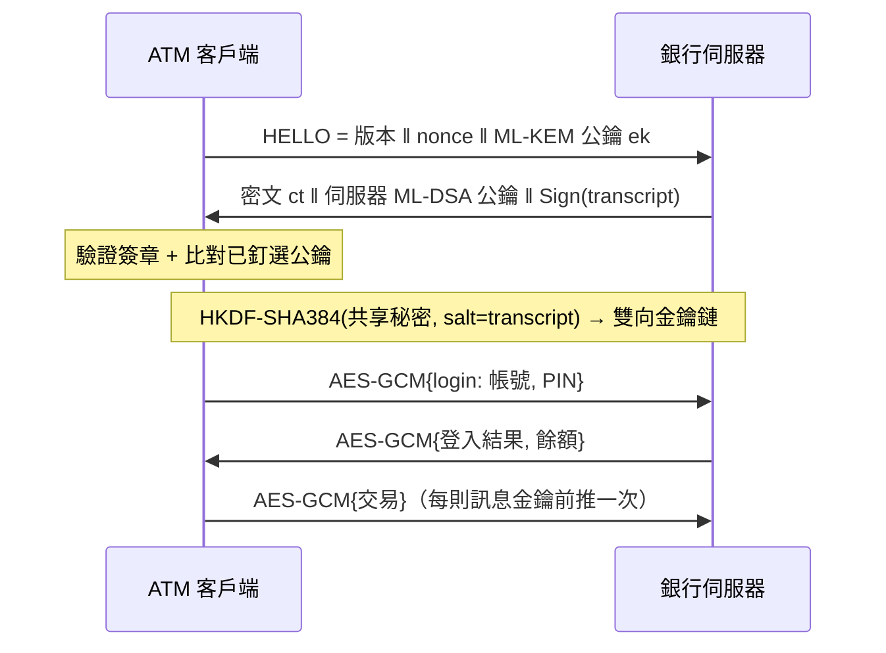

# 後量子密碼 ATM 系統
[](https://www.python.org/)

以後量子密碼學實作的 ATM 交易協議示範：ML-KEM-768 金鑰交換、ML-DSA-65 伺服器身分簽章、
AES-256-GCM 加密通道，並以「每則訊息一把金鑰」的金鑰棘輪實現交易唯一金鑰。

> ⚠️ 教學／研究用途的示範系統，帳戶資料存在記憶體中，並未經過正式安全稽核，請勿用於真實金融環境。

## 核心功能
- ✅ 帳號 + PIN 登入（scrypt 雜湊，連續錯 3 次鎖定 5 分鐘）
- ✅ 存款 / 取款 / 轉帳 / 餘額查詢
- ✅ 抗量子金鑰交換（ML-KEM-768, FIPS 203）
- ✅ 伺服器身分驗證：ML-DSA-65（FIPS 204）簽署握手內容，客戶端釘選伺服器公鑰，可偵測中間人攻擊
- ✅ 每則訊息獨立金鑰（HMAC 金鑰棘輪，具前向安全性）
- ✅ AES-256-GCM + 訊息序號，可偵測竄改、重放、重排
- ✅ 金額以 `Decimal` 處理（無浮點誤差），伺服器端完整驗證輸入
- ✅ 多執行緒安全的帳務操作（含防死結的轉帳鎖順序）
- ✅ GUI 網路操作在背景執行，介面不會凍結
- ✅ 伺服器握手逾時（10 秒）與同時連線上限（64），降低被大量連線拖垮的風險

## 協定流程


## 快速開始
```bash
pip install -r requirements.txt

# 1. 啟動伺服器（第一次會產生 server_identity.key 並顯示公鑰指紋）
python server_mlkem.py            # 可加 --host / --port

# 2. 啟動客戶端（需要 Tkinter）
python client_mlkem.py
```
「伺服器」欄位可填 `主機` 或 `主機:埠號`（例如 `192.168.1.5:6000`），不填埠號時使用 5000。

第一次連線時，客戶端會顯示伺服器公鑰指紋，請與伺服器終端機上顯示的指紋比對後再按「是」。
之後指紋會記錄在 `known_servers.json`，若伺服器公鑰改變會拒絕連線。

示範帳戶：

| 帳號 | PIN  | 初始餘額   |
|------|------|-----------|
| 1001 | 1234 | 100,000   |
| 1002 | 5678 | 50,000    |

## 測試
```bash
python -m unittest discover -v tests
```
- `tests/test_e2e.py`：正常交易流程、非法金額（負數、NaN、Infinity、超大數、超過兩位小數）、未登入操作、
  PIN 鎖定與解鎖、封包竄改、封包重放、伺服器公鑰替換、並發轉帳總額守恆、握手逾時、連線數上限。
- `tests/test_gui.py`：用真正的 Tkinter 視窗跑完整流程（首次連線確認指紋 → 登入 → 存款／取款／轉帳 →
  登出再登入、PIN 錯誤重試、伺服器換金鑰被拒、連線中斷後回到登入畫面）。
  沒有 Tkinter 或顯示器時會自動略過；無桌面的 Linux 可用 `xvfb-run python -m unittest discover -v tests`。
- `tests/test_architecture.py`：檢查模組依賴方向與檔案大小上限（規則見 AGENTS.md）。

## 安全機制
| 技術 | 實現目標 |
|------|---------|
| ML-KEM-768 | 後量子安全的金鑰交換 |
| ML-DSA-65 簽署握手 transcript + 公鑰釘選 | 伺服器身分驗證，防中間人攻擊 |
| HKDF-SHA384（salt = transcript hash） | 金鑰與本次握手內容綁定 |
| HMAC 金鑰棘輪 | 每則訊息唯一金鑰、前向安全 |
| AES-256-GCM + 序號（nonce / AAD） | 機密性、完整性、防重放 |
| scrypt PIN 雜湊 + 限時鎖定 | 防暴力破解 PIN |

## 專案結構
```
wire.py            訊息契約（請求／回應格式、金額規則）
protocol.py        握手與加密通道
bank.py            帳務邏輯
server_mlkem.py    銀行伺服器（網路層、請求分派）
atm_client.py      客戶端核心（連線、公鑰釘選、輸入解析）
client_mlkem.py    ATM 畫面（Tkinter）
tests/             端到端、GUI 流程與架構規則測試
```
要修改或擴充這個專案（不論是人或 AI 模型），請先讀 [AGENTS.md](AGENTS.md)：裡面有模組分工、
依賴規則、「改什麼只需要讀哪些檔」的對照表與更新流程。

## 未來擴展
- [ ] 帳戶資料持久化（SQLite）與交易日誌
- [ ] ATM 端身分驗證（每台 ATM 註冊 ML-DSA 公鑰）
- [ ] 整合硬體安全模組（HSM）
- [ ] 支援 EMV 晶片卡動態驗證
- [ ] 混合金鑰交換（X25519 + ML-KEM）
